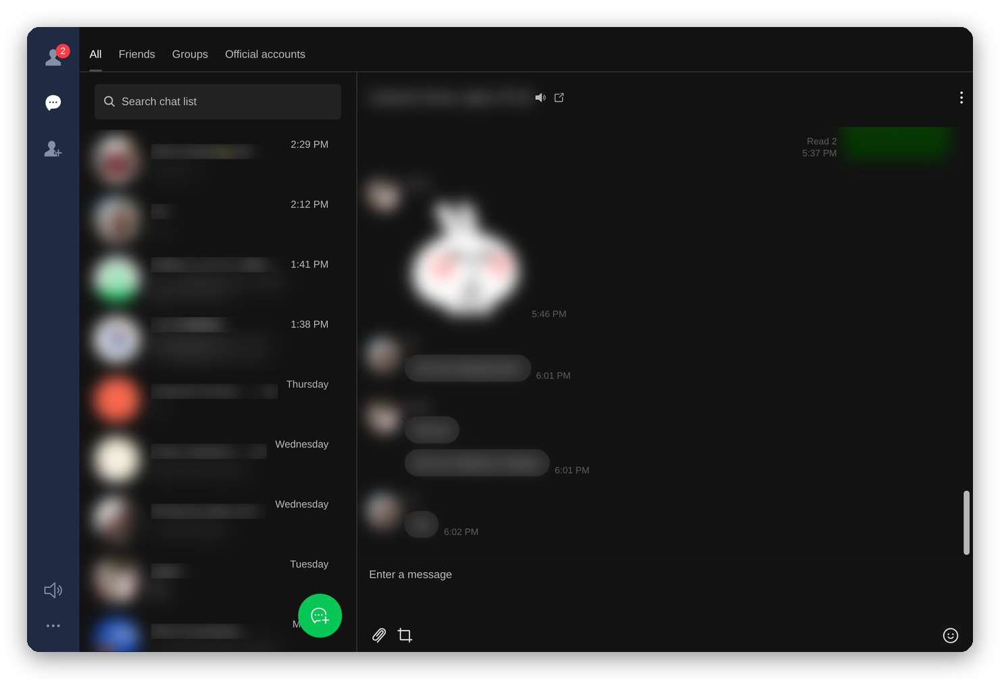

<p align="center">
  
</p>

<h1 align="center">Twine</h1>

<p align="center"><em>Chat on LINE from your GNOME desktop.</em></p>

Twine is an unofficial Flatpak app that runs the official
[LINE Chrome extension](https://chromewebstore.google.com/detail/line/ophjlpahpchlmihnnnihgmmeilfjmjjc)
in its own desktop window. It works like a normal GNOME app, with its own
launcher entry, icon, dock grouping, Adwaita-styled window controls and
desktop notifications.

| Light | Dark |
| --- | --- |
|  |  |

*Chats and contacts are blurred in these screenshots.*

### Features

- **A real LINE client.** It runs LINE's own extension, so chats, stickers,
  photos and Letter Sealing encryption work just as they do in Chrome.
- **Fits into GNOME.** It has its own launcher entry, icon and dock entry,
  native desktop notifications, and Adwaita-styled window controls.
- **Dark mode.** Choose Follow System, Light or Dark from the ☰ button in
  LINE's sidebar or the window's right-click menu. The change applies right
  away.
- **Zoom.** Make text and everything else bigger or smaller from the same
  menus, or with Ctrl + Plus, Ctrl + Minus and Ctrl + 0. Twine remembers the
  zoom level.
- **Runs in the background.** Closing the window keeps Twine running, so
  new messages still notify you. It's listed under Background Apps in Quick
  Settings, and opening Twine again brings the window back. Quit from the ☰
  menu, the right-click menu, Background Apps, or with Ctrl+Q. "Run in
  Background" can be switched off in the ☰ menu.
- **Start at Login** (optional, off by default). Turn it on in the ☰ menu or
  the right-click menu, and Twine starts hidden in Background Apps when you
  log in.
- **Keyboard shortcuts.** Ctrl+? (or Keyboard Shortcuts in the ☰ menu) opens
  GNOME's shortcuts window.
- **Stays logged in** between restarts.
- **Snaps to half the screen.** LINE's layout is adjusted so the window fits
  GNOME's side-by-side tiling.
- **Sandboxed.** It runs inside Flatpak with its own private browser profile,
  separate from your normal browser.

> This project is not affiliated with or endorsed by LY Corporation. "LINE"
> and the LINE logo are trademarks of LY Corporation. This repository has no
> LINE code or assets. The extension is downloaded from Google's Chrome Web
> Store update service when you build the app.

## About this project

I'm not a web developer. I just wanted a way to use LINE from my Linux PC,
and LINE has no app for Linux.

**AI disclosure:** most of the code and documentation in this repository was
written with the help of AI ([Claude Code](https://claude.com/claude-code)
by Anthropic). I tested it on my own computer, but it hasn't been reviewed by
experienced web or Chromium developers, so please read the code before you
rely on it. Bug reports and pull requests are welcome.

## How it works

The LINE extension is a Manifest V3 extension. It uses a module service
worker and the `downloads`, `notifications`, `system.display` and `cookies`
APIs, plus sandboxed pages. Electron and WebKitGTK don't implement those
APIs, so the app bundles a real Chromium:

| Piece | What it is |
| --- | --- |
| Runtime | `org.gnome.Platform` 51 |
| Base | `org.electronjs.Electron2.BaseApp` 26.08, which provides [zypak](https://github.com/refi64/zypak) so Chromium's sandbox works inside Flatpak |
| Browser | An unbranded Chromium snapshot build, pinned by revision and sha256. Branded Google Chrome ignores `--load-extension` since v137, but Chromium still supports it. |
| Extension | The `.crx` from the Web Store, pinned by sha256 and unpacked by `tools/crx_unpack.py` |

`tools/crx_unpack.py` reads the developer public key from the CRX3 header and
writes it into `manifest.json` as `"key"`. The unpacked extension therefore
keeps its official ID (`ophjlpahpchlmihnnnihgmmeilfjmjjc`), so its
`chrome-extension://` origin is the one LINE's servers expect. The script also
removes `update_url` so the pinned copy never auto-updates.

### Opening the window

Passing `--app=chrome-extension://…/index.html` to Chromium doesn't work
reliably. Chromium loads command-line extensions asynchronously, so the window
can open before the extension is ready, and the page fails with
`ERR_BLOCKED_BY_CLIENT`. Twine starts in two steps instead:

1. `data/twine.sh` opens a local splash page
   (`file:///app/share/twine/splash.html`) as an app window. That page always
   loads, and it keeps Chromium running while the extension loads.
2. The build points the extension's manifest at Twine's bootstrap service worker
   (`data/bootstrap/twine-bg.js`), which imports LINE's own `background.js`.
   When it starts, the bootstrap waits for the splash window and navigates it
   to LINE. It stores the window ID under LINE's own `mainWindow` key.

If Twine is already running, the launcher detects this through Chromium's
singleton socket, not the lock file, which can be left behind after a crash.
It then opens `twine-activate.html`, which asks the bootstrap to focus the LINE
window and closes itself.

Chromium only re-registers an extension's service worker when the extension
version changes. After a Twine update, it would therefore keep running the old
bootstrap. To avoid that, `data/twine-prefs.py` clears Chromium's cached
service workers whenever Flatpak's `app-commit` changes. LINE's data is kept.

### Looking at home on GNOME

- **Window frame**: Chromium can't use a libadwaita header bar, and on Wayland
  it has to draw its own title bar, which doesn't look like GNOME's. Twine
  therefore runs Chromium on X11 (XWayland) with "use system title bar", which
  `data/twine-prefs.py` sets before each start. GNOME's window manager then
  draws the native Adwaita title bar, buttons and light or dark style around
  the window, as it does for other X11 apps. It is GNOME's standard title bar
  height, a little shorter than the header bars in libadwaita apps.
- **Window title**: `data/bootstrap/twine-title.js` is added to LINE's
  `index.html` and keeps the window title as "Twine", including when LINE
  changes it later.
- **Dock and icon**: the launcher passes `--class=io.github.twinechat.Twine`,
  which sets the X11 WM_CLASS and the Wayland app_id. GNOME then matches the
  window to the `.desktop` file and its icon.
- **Icon**: `data/io.github.twinechat.Twine.svg` is an original Adwaita-style
  icon, a green speech bubble with a loop of twine.
- **Dark mode**: LINE's page has no dark theme of its own, so Twine uses
  Chromium's built-in auto dark mode, which recolours the page when it is
  drawn without changing LINE's files. To choose **Follow System**, **Light**
  or **Dark**, right-click an empty area of the Twine window (for example the
  left sidebar) and open **Appearance**, or right-click Twine's icon in the
  dock or app grid. Changes apply instantly, and with Follow System (the
  default) Twine switches as soon as GNOME's style changes.

  How it works: the bootstrap worker turns auto dark mode on or off for each
  page with the DevTools command `Emulation.setAutoDarkModeOverride`, sent
  through the `chrome.debugger` extension API. No debugging port is opened,
  and `--silent-debugger-extension-api` hides Chromium's "started debugging"
  bar. The worker keeps a native messaging connection open to
  `data/twine-settings-host.py`, which reports the saved choice
  (`~/.var/app/io.github.twinechat.Twine/config/twine/appearance`) and GNOME's
  style (watched through the settings portal), and saves choices made in the
  menu. The open connection also keeps the worker, and so the dark mode,
  alive. The build adds the `contextMenus`, `nativeMessaging` and `debugger`
  permissions to the extension. `debugger` belongs to the whole extension,
  but it only reaches pages inside Twine's own Chromium, which is LINE itself.
  Colours are converted automatically, so a few elements may look slightly
  different from LINE's design.
- **Popup windows**: LINE's photo viewer and popped-out chats are popup
  windows. LINE opens each at the size it saved for that kind of popup, then
  corrects the size with `resizeBy(wanted - measured)`. Under Twine, that
  correction runs before the window is on screen, when Chromium reports its
  outer size as 0×0 (and before the zoom level applies), so the window
  collapses to Chromium's smallest size, 100×100, and gets scroll bars. The
  bootstrap worker remembers the size each popup was created with and puts it
  back right away if the popup collapses in its first seconds. As a safety
  net, it also checks once the popup has loaded whether the content overflows
  the window and enlarges it to fit. LINE copies the main window's stylesheets
  into its popups, so Twine's minimum layout size (`twine-layout.js`) only
  applies when the page holds LINE's main layout, and
  `twine-settings-host.py` sets the minimum window size on the main window
  only (popups have the same X11 class and role).
- **Notifications**: Twine sends LINE's notifications through GNOME's
  notification portal, as GNOME apps do, instead of letting Chromium send
  them. `data/bootstrap/twine-notifications.js` wraps `chrome.notifications`
  in LINE's page and hands each notification (title, text, picture) to the
  bootstrap worker, which passes it to `data/twine-settings-host.py`, which
  sends it to the portal (category `im.received`, normal priority). Compared
  with Chromium's notifications, they:
  - stay in GNOME's notification list after Twine quits,
  - are hidden during Do Not Disturb (LINE asks for `requireInteraction`,
    which Chromium sends as *critical*, and GNOME shows critical
    notifications even during Do Not Disturb),
  - have no **Settings** button (Chromium adds one to each of its
    notifications).

  LINE also removes each notification a few seconds after showing it, which
  would take it out of GNOME's list. Those removals are skipped while the
  Twine window isn't focused or is hidden, so missed messages stay in the list
  until you dismiss or click them.

  Clicking a notification calls LINE's own click handler, so LINE opens the
  chat. If the portal isn't available, notifications go to Chromium as before
  (without `requireInteraction`). Chromium's **Settings** button would open
  Chromium's settings in a browser window, so the bootstrap worker (`tabs`
  permission) closes any `chrome://` page as soon as it opens and shows the
  Twine window instead. The launcher sets `CHROME_DESKTOP`, so those appear
  under Twine's name and icon.
- **Opening Twine through D-Bus**: like GNOME's own apps, Twine is D-Bus
  activatable (`DBusActivatable=true` in the desktop file). While it runs,
  `data/twine-settings-host.py` owns the bus name `io.github.twinechat.Twine`
  and answers GNOME's `org.freedesktop.Application` requests: *Activate* (the
  app grid) shows the window, and *ActivateAction* handles clicked
  notifications (`open-chat`), the dock menu's appearance actions, and `quit`
  (Background Apps in Quick Settings). If Twine isn't running, the bus starts
  it first (`data/io.github.twinechat.Twine.service`), so clicking a
  notification after quitting opens Twine.
- **Closing the window**: LINE's page always asks Chromium for a "Leave
  site?" confirmation when it is closed, even with nothing unsaved. Through
  its debugger session the bootstrap worker answers it
  (`Page.javascriptDialogOpening` of type `beforeunload`), so the window
  closes, or hides (see below), without asking. Chromium asks the same before
  a reload; those are told apart by the navigation request just before, and
  accepted. Chromium only asks at all once the page has been used, so the
  worker marks LINE's page as used when it loads (`Runtime.evaluate` with
  `userGesture`). Other dialogs are left alone.
- **Running in the background**: LINE's page, not its background script,
  holds the connection and shows the notifications, so it has to stay open.
  With "Run in Background" on (the default), closing the main window cancels
  the close, and `data/twine-settings-host.py` withdraws the X11 window
  instead. GNOME then sees Twine running with no windows and lists it under
  Background Apps. Chromium doesn't notice, so LINE keeps running at full
  speed. Opening Twine again (through `twine-activate.html`) or clicking a
  notification maps the window again. The helper asks for permission through
  the Background portal; if GNOME denies it, or under
  `--ozone-platform=wayland`, where the window can't be hidden, closing quits.
  Quit closes every window and accepts the confirmation, so Chromium exits.
- **Start at Login**: the helper's Background portal request also carries the
  "Start at Login" choice, so GNOME adds or removes Twine from the login items
  (`twine --twine-autostart`). Every request includes it, since one without it
  would turn autostart off. Started at login, the launcher sets
  `TWINE_START_HIDDEN`, and the window is hidden as soon as it can be (with
  "Run in Background" on).
- **Keyboard Shortcuts**: Ctrl+? opens libadwaita's own shortcuts dialog
  (`AdwShortcutsDialog`) as a real GTK window, attached to Twine's window
  like other GNOME modal dialogs. The helper runs `data/twine-shortcuts.py`.
  GTK only marks windows as modal dialogs of its own windows, so once the
  dialog is shown, the script waits until GNOME has taken it on, withdraws it,
  gives it the properties of a modal dialog of Twine's window
  (`WM_TRANSIENT_FOR`, `_NET_WM_WINDOW_TYPE_DIALOG`, `_NET_WM_STATE_MODAL`),
  and maps it again. GNOME then attaches it ("attach-modal-dialogs").
- **Profile**: Chromium uses a private profile in
  `~/.var/app/io.github.twinechat.Twine/config/chromium`.
- **Staying logged in**: LINE's login session is a cookie without an expiry
  date (`lct`), which Chromium normally drops when it quits. `data/twine-prefs.py`
  turns on Chromium's "Continue where you left off", which keeps session
  cookies across restarts. Because Twine always starts with `--app`, Chromium
  doesn't reopen old windows.
- **Window size**: the first window opens at 960×680. After that, Chromium
  remembers the size you leave it at. LINE's page has a minimum size of
  780×490 (on its `#root` element) and shows scroll bars when the window is
  smaller. That is more than half of many screens, and GNOME only offers
  half-screen snapping when the window's minimum width fits in half the
  screen. So `data/bootstrap/twine-layout.js` lets the chat list shrink from
  328px to 240px in narrow windows and sets the page's minimum to 680×490
  (62px sidebar + 240px chat list + 375px conversation, rounded up). The
  window can't be made smaller than that. When you zoom in, the minimum grows
  with the zoom level (for example 850×613 at 125%), but never beyond the
  screen's usable area. If the window is too small after zooming in, it grows
  to fit. Extensions can't set a minimum window size, and Chromium sets none,
  so the bootstrap worker works out the minimum and
  `data/twine-settings-host.py` writes it into the X11 window's
  `WM_NORMAL_HINTS` (scaled by `Xft.dpi`). GNOME's window manager then
  enforces it while you resize. Under `--ozone-platform=wayland` that doesn't
  work, so the bootstrap worker grows the window back to the minimum after a
  resize instead.

## Building

Requirements: `flatpak`, `flatpak-builder` and the Flathub remote.

```sh
flatpak install flathub org.gnome.Platform//51 org.gnome.Sdk//51 \
    org.electronjs.Electron2.BaseApp//26.08

flatpak-builder --force-clean --user --install --repo=repo \
    build io.github.twinechat.Twine.yml
```

Then launch **Twine** from the GNOME app grid, or run:

```sh
flatpak run io.github.twinechat.Twine
```

Log in with your email and password or with the QR code. LINE may ask you to
confirm the login on your phone the first time.

### Making a bundle file

```sh
flatpak build-bundle repo twine.flatpak io.github.twinechat.Twine
flatpak install --user twine.flatpak
```

## Updating LINE or Chromium

The extension and Chromium are both pinned by sha256. When LINE publishes a new
extension version, the download no longer matches the pinned hash and the build
fails. To re-pin and rebuild, run:

```sh
tools/update-sources.sh            # both
tools/update-sources.sh extension  # just LINE
tools/update-sources.sh chromium   # just Chromium (nearest snapshot to Stable)
flatpak-builder --force-clean --user --install --repo=repo build io.github.twinechat.Twine.yml
```

When you update, also add a `<release>` entry to
`data/io.github.twinechat.Twine.metainfo.xml`.

## Permissions

| Permission | Why |
| --- | --- |
| `--share=network` | Talking to LINE's servers |
| `--socket=x11`, `--device=dri`, `--share=ipc` | Display (through XWayland, for the native title bar) and GPU acceleration |
| `--socket=pulseaudio` | Notification sounds and voice messages |
| `--talk-name=org.freedesktop.Notifications` | Desktop notifications for new messages |
| `--filesystem=xdg-download` | Saving received files and images |

## Troubleshooting

- **Debugging the extension**: run
  `flatpak run io.github.twinechat.Twine --remote-debugging-port=9222`, then open
  `chrome://inspect` in any Chromium-based browser. The launcher passes any
  extra arguments through to Chromium.
- **Native Wayland instead of X11** (Chromium then draws its own frame): run
  `flatpak run --socket=wayland io.github.twinechat.Twine --ozone-platform=wayland`.
- **Resetting all data and logging out**: run
  `rm -rf ~/.var/app/io.github.twinechat.Twine`.
- **"`--ozone-platform=wayland` is not compatible with Vulkan" in the log**: this
  message is harmless.

## Layout

```
io.github.twinechat.Twine.yml      Flatpak manifest
data/twine.sh                      Launcher (installed as /app/bin/twine)
data/twine-prefs.py                Prepares the profile: GTK theme, service-worker reset
data/twine-settings-host.py        Native messaging helper: settings and GNOME style
data/splash.html                   Startup window shown while the extension loads
data/bootstrap/                    Files added to the extension: bootstrap worker,
                                   twine-activate.html focus page, title script,
                                   layout changes, ☰ menu (twine-menu.js)
data/*.desktop, *.metainfo.xml     Desktop entry and AppStream metadata
data/*.service                     D-Bus service file (starts Twine on activation)
data/*.svg                         App icon
tools/crx_unpack.py                CRX3 to unpacked extension, keeping the store ID
tools/update-sources.sh            Re-pins the extension and Chromium hashes
```

## License

The code in this repository is licensed under the GNU General Public License
v3.0 or later (see `LICENSE`). The LINE extension and Chromium, which are
downloaded at build time, are not covered by this license and keep their own
licenses.
