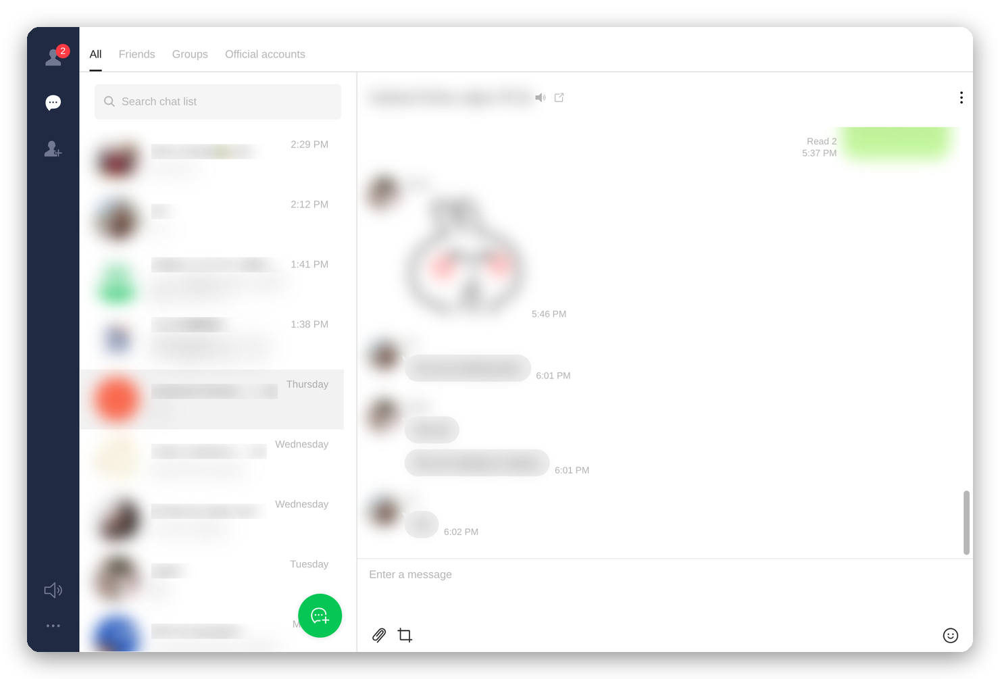

# Twine

*Chat on LINE from your GNOME desktop.*

Twine is an unofficial Flatpak app that runs the official
[LINE Chrome extension](https://chromewebstore.google.com/detail/line/ophjlpahpchlmihnnnihgmmeilfjmjjc)
in its own desktop window. It works like a normal GNOME app, with its own
launcher entry, icon, dock grouping, Adwaita-styled window controls and
desktop notifications.

| Light | Dark |
| --- | --- |
|  |  |

*Chats and contacts are blurred in these screenshots.*

### Features

- **A real LINE client.** It runs LINE's own extension, so chats, stickers,
  photos and Letter Sealing encryption work just as they do in Chrome.
- **Fits into GNOME.** It has its own launcher entry, icon and dock entry,
  native desktop notifications, and Adwaita-styled window controls.
- **Dark mode.** Choose Follow System, Light or Dark from the window's
  right-click menu. The change applies right away.
- **Sandboxed.** It runs inside Flatpak with its own private browser profile,
  separate from your normal browser.

> This project is not affiliated with or endorsed by LY Corporation. "LINE"
> and the LINE logo are trademarks of LY Corporation. This repository has no
> LINE code or assets. The extension is downloaded from Google's Chrome Web
> Store update service when you build the app.

## About this project

I'm not a web developer. I just wanted a way to use LINE from my Linux PC,
and LINE has no app for Linux.

**AI disclosure:** most of the code and documentation in this repository was
written with the help of AI ([Claude Code](https://claude.com/claude-code)
by Anthropic). I tested it on my own computer, but it hasn't been reviewed by
experienced web or Chromium developers, so please read the code before you
rely on it. Bug reports and pull requests are welcome.

## How it works

The LINE extension is a Manifest V3 extension. It uses a module service
worker and the `downloads`, `notifications`, `system.display` and `cookies`
APIs, plus sandboxed pages. Electron and WebKitGTK don't implement those
APIs, so the app bundles a real Chromium:

| Piece | What it is |
| --- | --- |
| Runtime | `org.gnome.Platform` 51 |
| Base | `org.electronjs.Electron2.BaseApp` 26.08, which provides [zypak](https://github.com/refi64/zypak) so Chromium's sandbox works inside Flatpak |
| Browser | An unbranded Chromium snapshot build, pinned by revision and sha256. Branded Google Chrome ignores `--load-extension` since v137, but Chromium still supports it. |
| Extension | The `.crx` from the Web Store, pinned by sha256 and unpacked by `tools/crx_unpack.py` |

`tools/crx_unpack.py` reads the developer public key from the CRX3 header and
writes it into `manifest.json` as `"key"`. The unpacked extension therefore
keeps its official ID (`ophjlpahpchlmihnnnihgmmeilfjmjjc`), so its
`chrome-extension://` origin is the one LINE's servers expect. The script also
removes `update_url` so the pinned copy never auto-updates.

### Opening the window

Passing `--app=chrome-extension://…/index.html` to Chromium doesn't work
reliably. Chromium loads command-line extensions asynchronously, so the window
can open before the extension is ready, and the page fails with
`ERR_BLOCKED_BY_CLIENT`. Twine starts in two steps instead:

1. `data/twine.sh` opens a local splash page
   (`file:///app/share/twine/splash.html`) as an app window. That page always
   loads, and it keeps Chromium running while the extension loads.
2. The build points the extension's manifest at Twine's bootstrap service worker
   (`data/bootstrap/twine-bg.js`), which imports LINE's own `background.js`.
   When it starts, the bootstrap waits for the splash window and navigates it
   to LINE. It stores the window ID under LINE's own `mainWindow` key.

If Twine is already running, the launcher detects this through Chromium's
singleton socket, not the lock file, which can be left behind after a crash.
It then opens `twine-activate.html`, which asks the bootstrap to focus the LINE
window and closes itself.

Chromium only re-registers an extension's service worker when the extension
version changes. After a Twine update, it would therefore keep running the old
bootstrap. To avoid that, `data/twine-prefs.py` clears Chromium's cached
service workers whenever Flatpak's `app-commit` changes. LINE's data is kept.

### Looking at home on GNOME

- **Window frame**: Chromium can't use a libadwaita header bar, and on Wayland
  it has to draw its own title bar, which doesn't look like GNOME's. Twine
  therefore runs Chromium on X11 (XWayland) with "use system title bar", which
  `data/twine-prefs.py` sets before each start. GNOME's window manager then
  draws the native Adwaita title bar, buttons and light or dark style around
  the window, as it does for other X11 apps. It is GNOME's standard title bar
  height, a little shorter than the header bars in libadwaita apps.
- **Window title**: `data/bootstrap/twine-title.js` is added to LINE's
  `index.html` and keeps the window title as "Twine", including when LINE
  changes it later.
- **Dock and icon**: the launcher passes `--class=io.github.twinechat.Twine`,
  which sets the X11 WM_CLASS and the Wayland app_id. GNOME then matches the
  window to the `.desktop` file and its icon.
- **Icon**: `data/io.github.twinechat.Twine.svg` is an original Adwaita-style
  icon, a green speech bubble with a loop of twine.
- **Dark mode**: LINE's page has no dark theme of its own, so Twine uses
  Chromium's built-in auto dark mode, which recolours the page when it is
  drawn without changing LINE's files. To choose **Follow System**, **Light**
  or **Dark**, right-click an empty area of the Twine window (for example the
  left sidebar) and open **Appearance**, or right-click Twine's icon in the
  dock or app grid. Changes apply instantly, and with Follow System (the
  default) Twine switches as soon as GNOME's style changes.

  How it works: the bootstrap worker turns auto dark mode on or off for each
  page with the DevTools command `Emulation.setAutoDarkModeOverride`, sent
  through the `chrome.debugger` extension API. No debugging port is opened,
  and `--silent-debugger-extension-api` hides Chromium's "started debugging"
  bar. The worker keeps a native messaging connection open to
  `data/twine-settings-host.py`, which reports the saved choice
  (`~/.var/app/io.github.twinechat.Twine/config/twine/appearance`) and GNOME's
  style (watched through the settings portal), and saves choices made in the
  menu. The open connection also keeps the worker, and so the dark mode,
  alive. The build adds the `contextMenus`, `nativeMessaging` and `debugger`
  permissions to the extension. `debugger` belongs to the whole extension,
  but it only reaches pages inside Twine's own Chromium, which is LINE itself.
  Colours are converted automatically, so a few elements may look slightly
  different from LINE's design.
- **Notifications**: LINE's notifications are sent as native GNOME
  notifications. Chromium adds a **Settings** button to each one, which can't
  be removed without patching Chromium. It would open Chromium's settings in a
  browser window, so the bootstrap worker (`tabs` permission) closes any
  `chrome://` page as soon as it opens and shows the Twine window instead. The launcher sets `CHROME_DESKTOP`, so they appear under
  Twine's name and icon, and points `TMPDIR` at a directory GNOME can read, so
  sender pictures show up. Notifications only arrive while Twine is running:
  closing the window quits it.
- **Closing the window**: LINE's page always asks Chromium for a "Leave
  site?" confirmation when it is closed, even with nothing unsaved. Through
  its debugger session the bootstrap worker accepts that one confirmation
  (`Page.javascriptDialogOpening` of type `beforeunload`), so the window just
  closes. Other dialogs are left alone.
- **Profile**: Chromium uses a private profile in
  `~/.var/app/io.github.twinechat.Twine/config/chromium`.

## Building

Requirements: `flatpak`, `flatpak-builder` and the Flathub remote.

```sh
flatpak install flathub org.gnome.Platform//51 org.gnome.Sdk//51 \
    org.electronjs.Electron2.BaseApp//26.08

flatpak-builder --force-clean --user --install --repo=repo \
    build io.github.twinechat.Twine.yml
```

Then launch **Twine** from the GNOME app grid, or run:

```sh
flatpak run io.github.twinechat.Twine
```

Log in with your email and password or with the QR code. LINE may ask you to
confirm the login on your phone the first time.

### Making a bundle file

```sh
flatpak build-bundle repo twine.flatpak io.github.twinechat.Twine
flatpak install --user twine.flatpak
```

## Updating LINE or Chromium

The extension and Chromium are both pinned by sha256. When LINE publishes a new
extension version, the download no longer matches the pinned hash and the build
fails. To re-pin and rebuild, run:

```sh
tools/update-sources.sh            # both
tools/update-sources.sh extension  # just LINE
tools/update-sources.sh chromium   # just Chromium (nearest snapshot to Stable)
flatpak-builder --force-clean --user --install --repo=repo build io.github.twinechat.Twine.yml
```

When you update, also add a `<release>` entry to
`data/io.github.twinechat.Twine.metainfo.xml`.

## Permissions

| Permission | Why |
| --- | --- |
| `--share=network` | Talking to LINE's servers |
| `--socket=x11`, `--device=dri`, `--share=ipc` | Display (through XWayland, for the native title bar) and GPU acceleration |
| `--socket=pulseaudio` | Notification sounds and voice messages |
| `--talk-name=org.freedesktop.Notifications` | Desktop notifications for new messages |
| `--filesystem=xdg-download` | Saving received files and images |

## Troubleshooting

- **Debugging the extension**: run
  `flatpak run io.github.twinechat.Twine --remote-debugging-port=9222`, then open
  `chrome://inspect` in any Chromium-based browser. The launcher passes any
  extra arguments through to Chromium.
- **Native Wayland instead of X11** (Chromium then draws its own frame): run
  `flatpak run --socket=wayland io.github.twinechat.Twine --ozone-platform=wayland`.
- **Resetting all data and logging out**: run
  `rm -rf ~/.var/app/io.github.twinechat.Twine`.
- **"`--ozone-platform=wayland` is not compatible with Vulkan" in the log**: this
  message is harmless.

## Layout

```
io.github.twinechat.Twine.yml      Flatpak manifest
data/twine.sh                      Launcher (installed as /app/bin/twine)
data/twine-prefs.py                Prepares the profile: GTK theme, service-worker reset
data/twine-settings-host.py        Native messaging helper: settings and GNOME style
data/splash.html                   Startup window shown while the extension loads
data/bootstrap/                    Files added to the extension: bootstrap worker,
                                   twine-activate.html focus page, title script
data/*.desktop, *.metainfo.xml     Desktop entry and AppStream metadata
data/*.svg                         App icon
tools/crx_unpack.py                CRX3 to unpacked extension, keeping the store ID
tools/update-sources.sh            Re-pins the extension and Chromium hashes
```

## License

The code in this repository is licensed under the GNU General Public License
v3.0 or later (see `LICENSE`). The LINE extension and Chromium, which are
downloaded at build time, are not covered by this license and keep their own
licenses.
